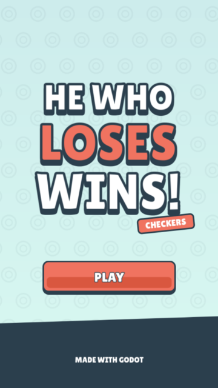
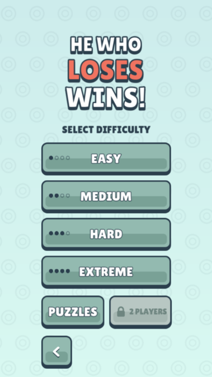
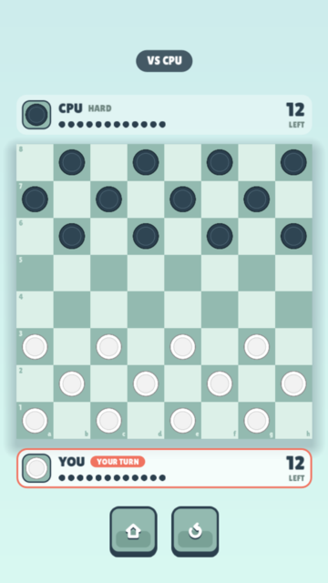
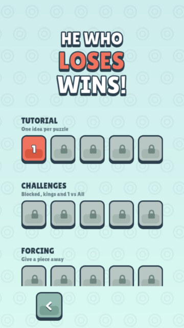

# He Who Loses Wins

<p align="center">
  
  
  
  
</p>

A checkers game where whoever loses wins: the first player to lose all their
pieces, or to run out of moves, wins the match. Built with Godot as a 2D web
game, to be published on itch.io, CrazyGames and other sites.

> **Status:** in development. The CPU opponent, 50 puzzles, the final art, UI
> and sound are done. Next on the [roadmap](docs/roadmap.md): a local
> two-player mode and a reward system.

## Play

Play the web build in your browser on
[GitHub Pages](https://tiago-xavier-braga.github.io/HeWhoLosesWins/). The
live build is updated by hand, so it can be behind `main`.

## Game modes

- **Vs CPU** — four difficulties: Easy, Medium, Hard and Extreme. You play
  white and move first.
- **Puzzles** — 50 puzzles in 10 sections, each teaching one idea, from
  Tutorial to Masters. Each starts from a fixed position, and you must lose all
  your pieces against the CPU within a move limit. Solve one to unlock the
  next. Progress is kept only until you close the game, for now.
- **2 Players** — two players on one device. Locked until Phase 3.

## How to play

It plays like checkers on an 8x8 board, but the goal is reversed:

- **Lose to win** — you win when you have no pieces left, or no legal move on
  your turn.
- **Capturing is mandatory** — if you can capture, you must, and you must take
  the sequence that captures the most pieces.
- **Flying kings** — a piece that reaches the opponent's last row becomes a
  king and moves any number of squares along a diagonal.

Click or tap one of your pieces to see where it can go: a dot for a move, a
ring for a capture.

## Documentation

- [Game design document](docs/gdd.md): the full rules and design.
- [Roadmap](docs/roadmap.md): the plan, phase by phase.
- [Puzzles](docs/puzzles.md): every level, its section and its solution.
- [Sound effects](docs/sound_effects.md): each sound, when it plays and where
  it comes from.
- [Playtest feedback](docs/feedback.md): player suggestions and bug reports.

## Requirements

- Godot `4.7` (GL Compatibility renderer)
- [LeafTween](https://github.com/tiago-xavier-braga/LeafTween), the tween
  library that animates the pieces, already included in `addons/leaf_tween/`

## Run locally

1. Install [Godot 4.7](https://godotengine.org/download).
2. Open `project.godot` in the editor.
3. Press **F5** to play.

## Web build

Install the Godot `4.7` export templates (**Editor → Manage Export
Templates**), then export the `Web` preset from the project folder:

```sh
mkdir -p build
godot --headless --export-release "Web" build/index.html
```

`build/` is git-ignored. Thread support is off, so the build doesn't need
cross-origin isolation headers and runs on static hosts such as GitHub Pages.
Serve it over HTTPS or from `localhost`: over plain HTTP from another device,
browsers block the features Godot needs.

## License

The source code is licensed under the [GNU GPL v3.0](LICENSE).
[LeafTween](https://github.com/tiago-xavier-braga/LeafTween), in
`addons/leaf_tween/`, is licensed under MIT.

The art, the music, the win and lose sounds, and the "He Who Loses Wins" name
and branding are **not** covered by the GPL: all rights reserved. They may not
be reused or redistributed without permission.

Third-party assets keep their own licenses:

- [Lilita One](assets/fonts/font_lilita_one_license.txt), the UI font, is
  licensed under the SIL Open Font License 1.1.
- The piece move and button click sounds are by
  [Kenney](https://www.kenney.nl) and released under CC0.
