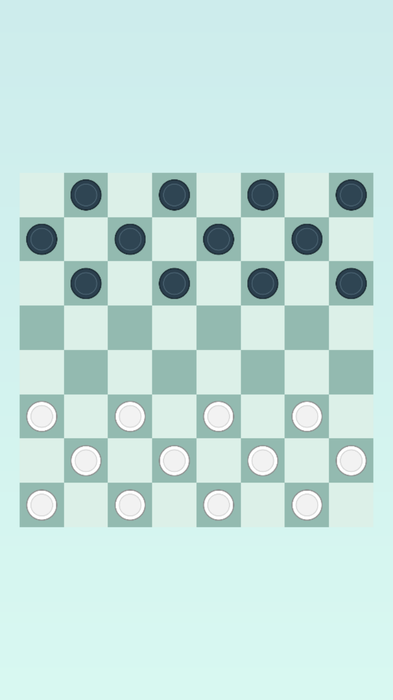

# He Who Loses Wins

<p align="center">
  
</p>

A checkers game where whoever loses wins: the first player to lose all their
pieces, or to run out of moves, wins the match. Built with Godot as a 2D web
game, to be published on itch.io, CrazyGames and other sites.

> **Status:** in development, Phase 1 of the [roadmap](docs/roadmap.md): a
> two-player match on one device, with placeholder art. A CPU opponent,
> puzzles, final art, UI and sound come in the next phases.

## Play

Play the web build in your browser on
[GitHub Pages](https://tiago-xavier-braga.github.io/HeWhoLosesWins/).

## How to play

It plays like checkers on an 8x8 board, but the goal is reversed:

- **Lose to win** — you win when you have no pieces left, or no legal move on
  your turn.
- **Capturing is mandatory** — if you can capture, you must, and you must take
  the sequence that captures the most pieces.
- **Flying kings** — a piece that reaches the opponent's last row becomes a
  king and moves any number of squares along a diagonal.

Click or tap one of your pieces to see where it can go: a dot for a move, a
ring for a capture.

See the [game design document](docs/gdd.md) for the full rules and the
[roadmap](docs/roadmap.md) for the plan, phase by phase.

## Requirements

- Godot `4.7` (GL Compatibility renderer)
- [LeafTween](https://github.com/tiago-xavier-braga/LeafTween), the tween
  library that animates the pieces, already included in `addons/leaf_tween/`

## Run locally

1. Install [Godot 4.7](https://godotengine.org/download).
2. Open `project.godot` in the editor.
3. Press **F5** to play.

## Web build

Install the Godot `4.7` export templates (**Editor → Manage Export
Templates**), then export the `Web` preset from the project folder:

```sh
mkdir -p build
godot --headless --export-release "Web" build/index.html
```

`build/` is git-ignored. Thread support is off, so the build doesn't need
cross-origin isolation headers and runs on static hosts such as GitHub Pages.
Serve it over HTTPS or from `localhost`: over plain HTTP from another device,
browsers block the features Godot needs.

## License

The source code is licensed under the [GNU GPL v3.0](LICENSE).
[LeafTween](https://github.com/tiago-xavier-braga/LeafTween), in
`addons/leaf_tween/`, is licensed under MIT.

Art, audio and the "He Who Loses Wins" name and branding are **not** covered
by the GPL: all rights reserved. They may not be reused or redistributed
without permission.
