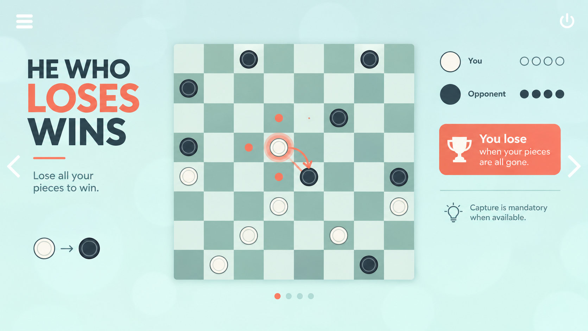

# GDD

## Pitch

A checkers game where whoever loses wins. You have to lose your pieces.

## Reference Image

## Overview

- **Genre:** Digital card/board game
- **Art:** 2D Minimalist
- **Platform:** Web build (itch.io)
- **References:** Checkers, Giveaway checkers (anti-checkers variant)

## Core Loop

1. Player does: moves a piece, trying to lose their own pieces
2. Game responds: the opponent moves a piece, also trying to lose theirs
3. Player decides: the best strategy to win the game
4. Repeat until:

## Rules

Played on an 8x8 board, only on the dark squares. Each player starts with 3
rows of pieces: white at the bottom, black at the top. White moves first and
turns alternate.

### Moving

- A piece moves one square diagonally forward, onto an empty square.
- A piece can never move backward or sideways, unless it is a king.
- A piece that reaches the opponent's last row becomes a king.
- A king moves like a bishop: any number of empty squares along a diagonal,
  in any direction.

### Capturing

- A piece captures by jumping diagonally over an adjacent opponent piece onto
  the empty square right behind it. The jumped piece is removed.
- Pieces can capture backward as well as forward.
- A king captures from a distance: it jumps the first piece on a diagonal
  (with only empty squares before it) and lands on any empty square behind it.
- A capture can continue: after landing, the same piece must keep capturing
  while it can, as one move.
- Pieces taken during a move stay on the board until the move ends, and none
  can be jumped twice.
- A man that ends a capture on the last row becomes a king. If it can keep
  capturing from there, it continues as a man and is only promoted at the end.

### Capture is mandatory

- If any capture is available, the player must capture. A normal move is not
  allowed.
- The player must take the sequence that captures the most pieces. There is
  no choice of a shorter one. If several sequences tie, the player may pick
  any of them.

### Winning

The goal is to lose, so the winner is the first player who:

- has no pieces left, or
- has no legal move on their turn (blocked).

### Input

- Click or tap one of your pieces to select it. The squares it can go to are
  highlighted: a dot for a move, a ring for a capture.
- Click or tap a highlighted square to move. For a multi-jump, any square on
  the path starts the whole forced capture.
